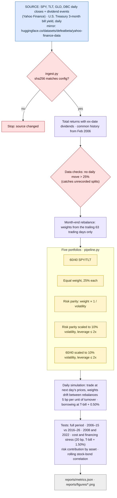
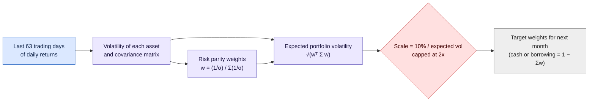

# How this project works

Two diagrams:
1. **Pipeline**: every step, its source file, and the logic inside it.
2. **Monthly sizing decision**: how each portfolio's weights are set at a rebalance.

Colour key: **blue** = external data source · **lavender** = code step · **yellow** = rule or model · **red** = check or gate · **grey** = output

## 1. Pipeline (what `make all` runs)

## 2. Monthly sizing decision

